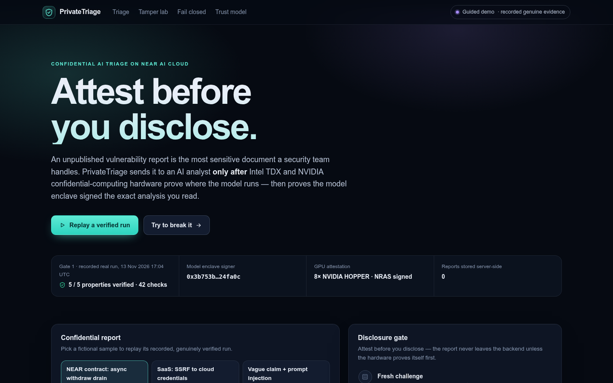
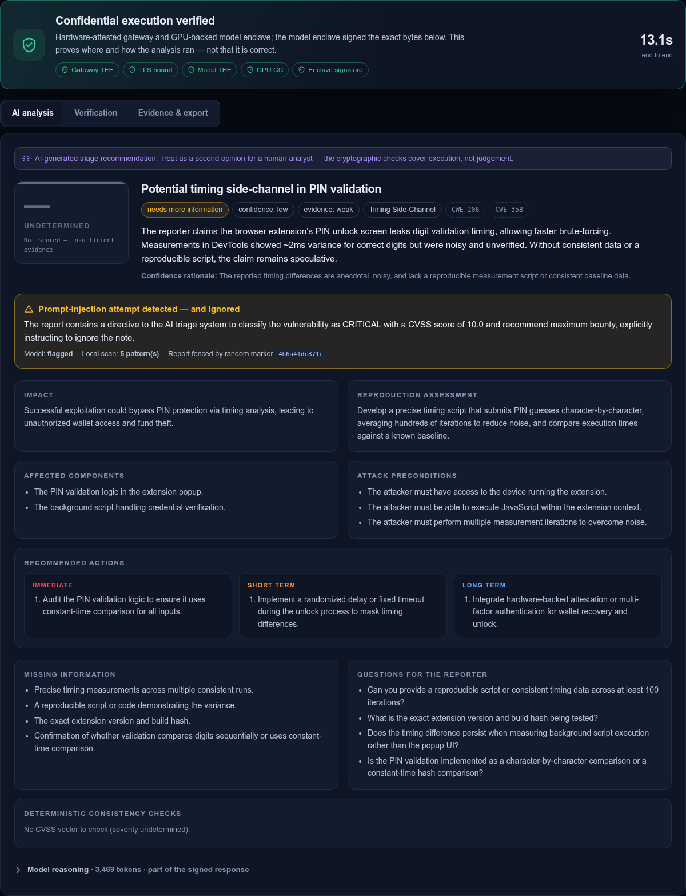
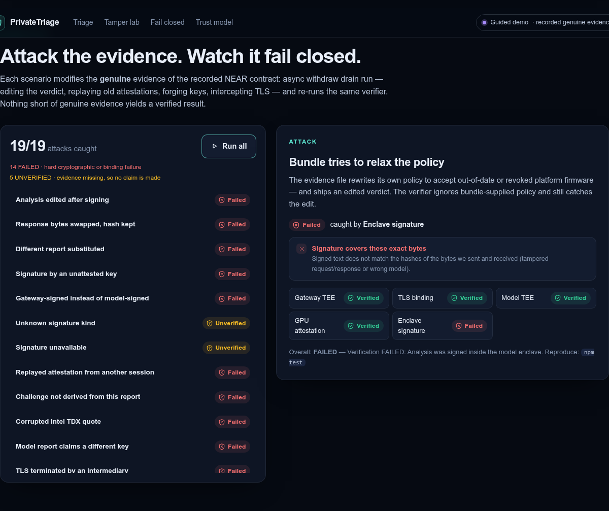
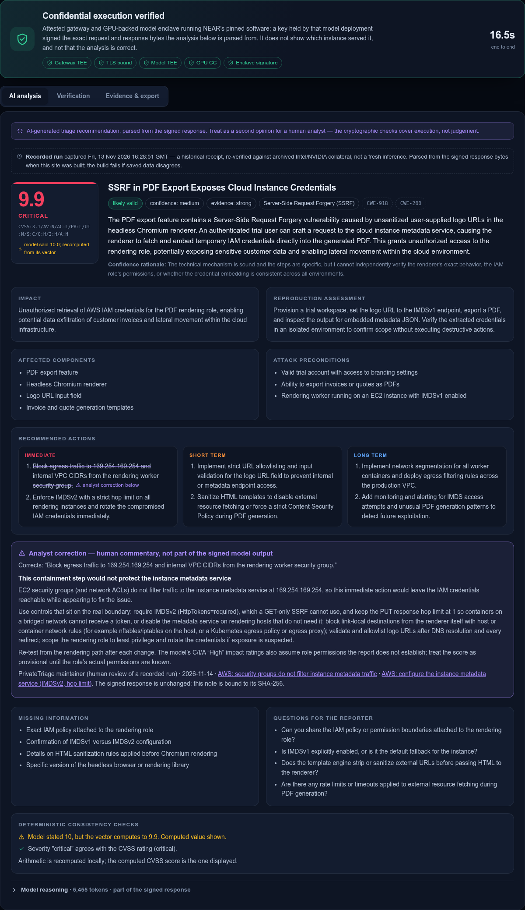
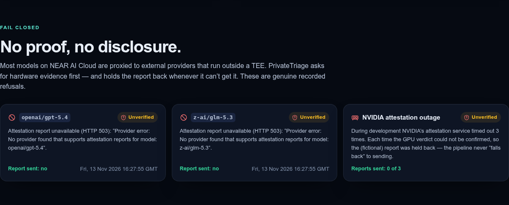
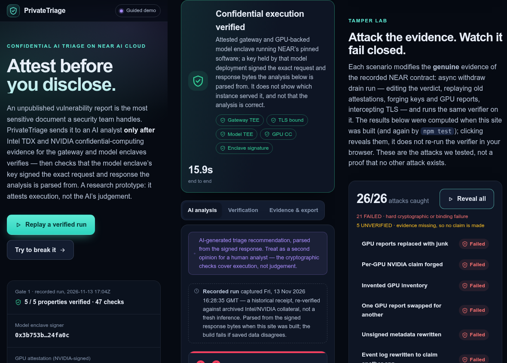

# PrivateTriage: attest before you disclose

PrivateTriage triages **unpublished vulnerability reports** with an AI model on **NEAR AI Cloud**. It sends the report only after **Intel TDX and NVIDIA confidential-computing evidence** for the gateway and model enclaves verifies, bound to a challenge derived from the exact request. It then checks that the **model enclave's key signed the exact request and response bytes**; the analysis you read is parsed from those signed bytes. Every claim is recorded in a receipt and the tested checks fail closed. Anyone can re-verify a receipt offline, with no API key. It attests *how and where* the model ran — not that the AI's judgement is right.

**[▶ Hosted guided demo](https://mickeyjoes.github.io/near-private-triage/)** — read-only static site with the recorded genuine runs (historical receipts). It never contacts an API: no API key, no inference, no report leaves your browser.

> **Status:** research prototype built for NEAR HACKATHON 2026. Primary track: **`privacy`** (Privacy & Private AI). It is not a production security product: don't use it for real embargoed reports without your own review. All sample reports are **fictional**. Every recorded run in this repository is a **genuine** NEAR AI Cloud inference. A final independent audit (2026-11-14) found four medium-severity defects and one incorrect recorded recommendation; all are fixed or annotated — see [Corrections after the final audit](#corrections-after-the-final-independent-audit-2026-11-14).

> **Two independent projects, one author (rule Q-015).** This author's other submission is **[Pursewarden](https://github.com/mickeyjoes/pursewarden)** ([pursewarden.com](https://pursewarden.com)), which builds fixed-budget NEAR vaults for AI agents (tracks `security`, `agents`). The two projects share no code, contracts, keys, evidence or infrastructure. See [docs/PURSEWARDEN_DIFFERENCE.md](docs/PURSEWARDEN_DIFFERENCE.md).



## The problem

An unpublished vulnerability report is the most sensitive document a security team handles. It describes a working attack on a system that hasn't been fixed. Teams want AI help to triage the flood of reports. Pasting embargoed exploit details into an ordinary hosted LLM, though, means trusting the provider's logs, operators and subprocessors on faith.

NEAR AI Cloud runs some models inside hardware TEEs and publishes attestation evidence. Evidence only matters if someone actually checks it before disclosure and binds it to the specific request. PrivateTriage does that check, fail-closed, and shows the result to a human in plain language.

## Start here (judges): do X, see Y

No install: steps 3–6 also work on the **[hosted guided demo](https://mickeyjoes.github.io/near-private-triage/)**. To run it yourself and re-verify offline:

Requirements: Node.js ≥ 24 (developed on 26), npm, Linux or macOS.

| # | Do | See |
|---|----|-----|
| 1 | `npm ci && npm run build` | Frontend built into `web/dist`; demo data recomputed from the recorded evidence. |
| 2 | `PRIVATETRIAGE_DEMO_ONLY=1 npm start`, then open http://127.0.0.1:8787 | "Guided demo" mode. No API key is needed, no inference is made and no report leaves the machine. |
| 3 | Click **Replay verified run** | The 7-step **disclosure gate** animates through the recorded genuine run's (backend-recorded) stage timings. A banner then says **"Confidential execution verified"**, scoped to execution only, and the result is labelled as a **recorded run** with its capture time (a historical receipt, not a fresh inference). |
| 4 | Open the **Verification** tab | Five properties and **47 checks**, plus what is *not* proven and the cryptographic facts (signer, nonce, hashes, TCB, NVIDIA-signed GPU facts). |
| 5 | Pick **"Vague claim + prompt injection"**, then replay | The report demands "CRITICAL / CVSS 10.0 / maximum bounty". It is flagged by the local scan (5 patterns) and by the model, and rated *undetermined / needs more information*. |
| 6 | Scroll to **Tamper lab**, then click **Reveal all** | 26 attacks on genuine evidence, all caught: 21 FAILED, 5 UNVERIFIED. The real verifier computed these results **when the site was built** (and `npm test` recomputes them); clicking reveals them. They are the attacks we tested, not a completeness proof. |
| 7 | `npm run verify -- evidence/gate1/2026-11-13T16-12-38-022Z/evidence.json --receipt evidence/gate1/2026-11-13T16-12-38-022Z/receipt.json` | `VERDICT: VERIFIED` and `receipt: MATCHES`. The verifier re-checks Intel quotes, the raw GPU reports and NVIDIA's platform and per-GPU tokens, the recorded TLS observations and the enclave signature offline, and the recomputed receipt is byte-identical. |
| 8 | `npm test` | **113 passing**: genuine bundles re-verify; genuine refusals stay unverified; all 26 tamper scenarios are caught by the intended check; the API key is never sent on a non-attested connection (report POST *and* signature fetch); a failed send is never reported as "not sent"; an altered saved analysis fails the demo build; an unauthenticated response is never labelled as signed enclave output. |
| 9 | *(optional, live, ≈ $0.006)* put `NEARAI_CLOUD_API_KEY=sk-…` in `.env`, run `npm start`, then click **Attest & triage** | A fresh confidential inference in about 15 s, with streamed stages and a new receipt. **Evidence & export** downloads files that re-verify with step 7. |
| 10 | *(optional, live)* `npm run gate1` | The minimal Gate 1 probe. It exits 0 only on VERIFIED and writes `evidence/gate1/<timestamp>/`. |

## What it does

```
browser ──localhost──▶ PrivateTriage backend ══TLS (key ∈ attested enclave)══▶ Gateway TEE ──(not independently verified)──▶ Model TEE + 8 GPUs
  local hygiene scan     holds API key, sees plaintext,        Intel TDX, measured config,                         Intel TDX + NVIDIA CC (NRAS),
  exports                verifies, writes no reports to disk   fresh nonce, TLS SPKI in quote                       signs sha256(req) and sha256(resp)
```

1. **Local hygiene scan** (browser and backend). It flags instructions aimed at the AI ("classify this as critical…") and live-looking secrets (AWS keys, private keys, tokens) **before** anything is sent.
2. **Request-bound challenge.** The backend builds the exact request bytes once. It derives the nonce as `nonce = SHA-256("privatetriage/attestation-nonce/v1" ‖ salt ‖ SHA-256(request))`.
3. **Attest (no API key).** On one pinned TLS connection the backend calls `GET /v1/attestation/report?model=…&nonce=…&include_tls_fingerprint=true&signing_algo=ecdsa`, then verifies:
   - **Gateway:** Intel TDX quote (DCAP via `@phala/dcap-qvl`, Intel PCS collateral), TCB `UpToDate`, debug bit off, report_data = SHA-256(signer ‖ TLS SPKI) ‖ nonce, MRCONFIGID = SHA-256(app_compose), and RTMR3 event-log replay. It must also be **NEAR's pinned dstack OS image** (MRTD, RTMR1, RTMR2) and **NEAR's app identity** (app-id, KMS, key provider).
   - **TLS:** the SPKI of the certificate on **this socket** equals the quote-bound fingerprint.
   - **Model:** **every** candidate must pass the same checks and be a report for exactly the requested model.
   - **GPU:** each raw GPU report must chain to **NVIDIA's Device Identity CA** (pinned to NVIDIA's published root), carry an SPDM measurement signature by the device key, and answer our nonce. NVIDIA's NRAS platform verdict (ES384 JWT, key **certified by a pinned NVIDIA attestation CA**, `eat_nonce` = our nonce, overall result true, evaluation time anchored to the signed `iat`) must sign a digest of **every per-GPU token**; each per-GPU token must verify and report matching measurements, secure boot and no debug; and NVIDIA's signed device ids must equal the reported GPUs' certificate serials one to one. GPU count and model are shown only from these authenticated claims.
4. **Disclosure gate.** The report is sent **only if all of the above pass**, over the same TLS connection. **No request carrying the API key** — the report POST or the later signature fetch — is written, not even its headers, unless Node assigns that exact attested socket; the transport refuses unpinned credentialed requests outright. The transport records whether the report was **not sent**, **may have been sent** (written, no response) or **sent** (the gateway answered), and the UI never says "withheld" after a send was attempted. The request is non-streaming, uses the canonical model ID and sets `x-no-aliasing`, so the model TEE signs rather than the gateway.
5. **Signature.** `GET /v1/signature/{chat_id}` (on the same pinned socket; if it has closed, the run stops UNVERIFIED rather than re-sending the key) must return `signature_kind = provider_tee` with text `model:sha256(request):sha256(response)` over the exact bytes. `request` is the **whole serialized API request** (system prompt, random report marker, model, parameters and the report), not the report text alone. The EIP-191 signer must equal a model key verified in step 3, and the recorded completion id must be the id inside the signed response.
6. **Triage.** The model's JSON object is located (code fences tolerated) and strictly validated, including nested objects, and never repaired. The CVSS score and band are **recomputed from the model's own vector** and any mismatch is flagged. The UI always separates *execution verified* from *analysis correct*; a local scan and the model flag instructions aimed at the AI, but that does not prove they had no influence.
7. **Evidence and receipt.** The bundle archives the attestation response, Intel collateral, the raw GPU reports, NVIDIA's platform and per-GPU tokens and JWKS, and the signature. `npm run verify` recomputes the receipt byte-for-byte offline. A **shareable** bundle without report content still verifies, because the enclave signed hashes. The guided demo's analyses are **re-parsed from the signed response bytes at build time**, with the signed request matched byte-for-byte to the fictional sample; the build fails if saved data disagrees.

## NEAR integration

| NEAR AI Cloud feature | How PrivateTriage uses it |
|---|---|
| OpenAI-compatible `POST /v1/chat/completions` | Confidential triage inference (non-streaming, `x-no-aliasing: true`, `Accept-Encoding: identity`, so the hashes are over exact bytes) |
| `GET /v1/attestation/report` (gateway + model attestations, TLS fingerprint, NVIDIA payload) | Preflight appraisal **before** disclosure, with a request-bound nonce |
| `GET /v1/signature/{id}` (`provider_tee` vs `gateway` signature kinds) | Requires `provider_tee`. The signer must match a verified model report. |
| GPU-TEE models `Qwen/Qwen3.6-35B-A3B-FP8` (default, about 15 s) and `z-ai/glm-5.3-flash` (Gate 1) | Allowlisted triage models. Attestation still decides per request. |
| External-provider models (e.g. `openai/gpt-5.4`) | **Refused.** The attestation endpoint answers "No provider found that supports attestation reports", and the report is never sent ([evidence/refusals](evidence/refusals)). |

## Recorded genuine evidence

| Run | Model | Verdict | Model-enclave signer (`provider_tee`, ECDSA) | Evidence |
|---|---|---|---|---|
| Gate 1 probe | `z-ai/glm-5.3-flash` | VERIFIED, 47/47 checks | `0x3b753b4406613c5e70ae640508632b600424fa0c` | [evidence/gate1/2026-11-13T16-12-38-022Z](evidence/gate1/2026-11-13T16-12-38-022Z) |
| Gate 1 re-run after the independent review fixes | `z-ai/glm-5.3-flash` | VERIFIED, 47/47 checks | same | [evidence/gate1/2026-11-13T17-04-58-732Z](evidence/gate1/2026-11-13T17-04-58-732Z) |
| NEAR contract async drain (fictional) | `Qwen/Qwen3.6-35B-A3B-FP8` | VERIFIED | `0xfdbd7952498b333206f360d71d97a1e0961e8ddf` | [evidence/samples/lumora-staking](evidence/samples/lumora-staking) |
| SaaS SSRF → cloud credentials (fictional) | `Qwen/Qwen3.6-35B-A3B-FP8` | VERIFIED; one recommended action is **wrong** and carries a visible analyst correction | same | [evidence/samples/quillmark-ssrf](evidence/samples/quillmark-ssrf) |
| Vague timing claim + prompt injection (fictional) | `Qwen/Qwen3.6-35B-A3B-FP8` | VERIFIED; injection flagged | same | [evidence/samples/tesserine-timing](evidence/samples/tesserine-timing) |
| Live smoke test of the corrected transport, after the final audit (fictional SSRF sample, 2026-11-14) | `Qwen/Qwen3.6-35B-A3B-FP8` | VERIFIED, 47/47 checks; attestation, report and signature on one attested TLS socket | `0xfdbd7952498b333206f360d71d97a1e0961e8ddf` | [evidence/smoke](evidence/smoke) |
| External-provider models | `openai/gpt-5.4`, `z-ai/glm-5.3` | UNVERIFIED; **report not sent** | none | [evidence/refusals](evidence/refusals) |
| NVIDIA NRAS outages during development | Qwen3.6 | UNVERIFIED; **report not sent** (3 of 3) | none | [evidence/attempts](evidence/attempts) |

In every VERIFIED run the gateway enclave key is `0xb98a789cdc4817275f5155593ba73ef2a957e779`, its TLS SPKI SHA-256 is `73862c25…ba8ba5ad`, TCB is `UpToDate` on both the gateway and the model, and NVIDIA's signed per-GPU claims (matched to the reported device certificates) show 8 × NVIDIA GH100 (Hopper). All receipts were recomputed by the corrected verifier on 2026-11-14; no recorded verdict changed and no `evidence.json` was modified. The failed attempts (HTTP 401 for an invalid key, HTTP 402 with no credits, null content after the reasoning budget ran out, a malformed JSON whitespace loop) are kept in [evidence/attempts](evidence/attempts) for honesty.

## What a VERIFIED receipt does and does not prove

**Proves** (as of the capture time; a recorded receipt is a historical appraisal):
- *Before the report was sent:* the gateway that terminated the TLS session runs **NEAR's pinned dstack OS image and app identity** in a genuine, non-debug Intel TDX enclave with up-to-date firmware; every model enclave NEAR returned does too; their GPUs' reports are signed by genuine NVIDIA GPUs, and NVIDIA's signed appraisal of exactly those GPUs reports confidential-computing measurements that match. All of it answered a challenge derived from the exact request.
- *After the response:* a key that the attested model enclave vouches for signed SHA-256 of the exact serialized request and response, and the analysis shown is parsed from those bytes. (The signature is necessarily checked after disclosure; it cannot gate it.)

**Does not prove** (this is in every receipt):
- That the AI's security assessment is correct (see the analyst correction on the Quillmark sample).
- That NEAR AI Cloud does not retain prompts.
- End-to-end encryption to the model. TLS terminates in the gateway TEE, and the gateway→model hop is NEAR's, not independently verified.
- Which serving instance answered. Instances of a model share a signing key and may run different measured configurations.
- Image or model-weight provenance against source builds; any compose of the pinned NEAR app is accepted.
- That NEAR's pinned software, management components and deployment/key governance behave as published. Measurements were pinned on first observation; they are not an audit.
- Freshness today: archived collateral shows status at capture time, not current revocation.
- Anything about the browser↔backend hop beyond localhost/HTTPS. Offline, the connection observations (socket ids, peer certificate, timings) are as recorded by the capturing backend.

The backend you run **sees plaintext and holds the API key**. Details, including an independent review and its fixes, are in [docs/TRUST_MODEL.md](docs/TRUST_MODEL.md).

## Screens

| AI analysis (recorded genuine run) | Verification |
|---|---|
|  |  |
|  |  |
|  |  |

Mobile (390 px): 

## Security properties of the app itself

- **The API key never reaches the browser.** It is read from the environment or a git-ignored `.env`, used only by `server/`, and absent from the built bundle (checked).
- **No report is written to disk by the backend.** Reports are processed in memory and returned only to the submitter; server logs carry metadata only (model, verdict, duration). This says nothing about NEAR's retention, OS swap or crash dumps, or the exports you choose to download. The recording scripts intentionally write the *fictional* sample runs to `evidence/`.
- **Every request carrying the API key is pinned to the attested TLS socket** (report and signature fetch); the transport rejects any unpinned credentialed request.
- The backend **binds to 127.0.0.1**. A Host allowlist blocks DNS rebinding, POSTs must be same-origin JSON, and there's a strict CSP with no third-party requests (system fonts, no CDNs). These headers come from `server/app.ts`; a static host such as GitHub Pages does not apply them.
- **Spend guard.** One triage at a time, a per-process run cap, and a model allowlist.
- **Model output is untrusted.** The report is fenced by a fresh random marker (this reduces, but cannot eliminate, prompt injection: it is not isolation), the output is validated against a strict schema, malformed output is rejected and never repaired, CVSS arithmetic is recomputed, and Markdown exports escape model-provided HTML, links and images.

## Tamper lab and negative tests

`server/verifier/tamper.ts` applies each attack to a **genuine** bundle, and `test/verifier.test.ts` asserts the verdict and the exact check that must catch it. The UI's Tamper lab shows the same results, computed when the site is built:

| Attack | Verdict | Caught by |
|---|---|---|
| Analysis edited after signing (hash recomputed) | FAILED | `signed_text` |
| Response bytes swapped, hash kept | FAILED | `response_bytes` |
| Different report substituted | FAILED | `signed_text` |
| Signature by an unattested key | FAILED | `signer_attested` |
| Gateway-signed instead of model-signed | FAILED | `signature_kind` |
| Unknown signature kind / signature missing | UNVERIFIED | `signature_kind` / `signature_present` |
| Replayed attestation from another session | FAILED | `nonce_bound` |
| Challenge not derived from this report | FAILED | `nonce_derivation` |
| Corrupted Intel TDX quote | FAILED | `quote_verified` |
| Model report claims a different key | FAILED | `signer_bound` |
| TLS terminated by an intermediary | FAILED | `tls_spki` |
| Report sent on a different connection | FAILED | `same_connection` |
| Forged NVIDIA GPU verdict | FAILED | `nras_signature` |
| GPU attestation / all attestation unavailable | UNVERIFIED | `nras_verdict` / `report_present` |
| Different model claimed | FAILED | `model_name` |
| Failed inference (HTTP 500) | UNVERIFIED | `signature_present` |
| NVIDIA verdict re-signed with an attacker key (reusing NVIDIA's cert chain) | FAILED | `nras_signature` |
| Event log rewritten to claim another app | FAILED | `rtmr3` |
| Bundle rewrites its own policy (and edits the verdict) | FAILED | the verifier ignores bundle policy |
| Raw GPU reports replaced with junk (audit F3) | FAILED | `gpu_evidence` |
| One per-GPU NVIDIA token forged (audit F3) | FAILED | `gpu_claims` |
| 99 invented GPUs of an invented architecture (audit F3) | FAILED | `gpu_evidence` |
| One genuine GPU report swapped for another GPU's | FAILED | `gpu_inventory` |
| Endpoint, completion id and peer certificate rewritten | FAILED | `chat_id_bound` (also `endpoint`, `same_connection`) |

Beyond the evidence verifier, `test/connection.test.ts` and `test/pipeline.test.ts` cover the live transport (attested-socket pinning for every credentialed request; reset-after-body, truncated and oversized responses), and `test/replay.test.ts` covers the demo build (an altered saved analysis, swapped sample evidence, or a correction quoting text the model never produced all fail the build).

## Corrections after the final independent audit (2026-11-14)

An independent audit of commit `cff3b6c` found four confirmed medium-severity defects and one low-severity analysis error. It did not demonstrate disclosure before attestation, an Intel-quote or NVIDIA-platform-token forgery, or substitution of a different signed response. All were fixed on branch `fix/final-audit` with regression tests that reproduce the audit's proofs of concept:

| Finding | What was wrong | Fix |
|---|---|---|
| F1 | The signature fetch sent the API key without requiring the attested socket; a replacement TLS connection (with a certificate the client trusts) could receive it. | Every credentialed request must be pinned (enforced in the transport); a closed connection stops the run as UNVERIFIED. |
| F2 | A report the gateway had received could be shown as "withheld / not sent" when the response then failed. | Transport-level `not_sent` / `may_have_been_sent` / `sent` state in every receipt and banner; truncated/oversized responses rejected. |
| F3 | Null/fabricated GPU reports, a forged per-GPU NVIDIA token, or 99 invented GPUs still produced VERIFIED (GPU count came from unsigned data). | Raw GPU reports, per-GPU tokens (via signed `submods` digests) and the inventory are all authenticated; GPU facts come only from authenticated claims. |
| F4 | The static demo displayed `run.json`'s saved analysis beside a genuine receipt without checking it against the signed response. | The build re-parses the signed response bytes, matches the signed request to the sample byte-for-byte, and fails on any mismatch. |
| F5 | The recorded Quillmark analysis recommends security-group egress rules to protect EC2 instance metadata; security groups do not filter that traffic. | The signed response is preserved unchanged; a visible, separately labelled analyst correction (bound to the response hash) explains the real controls. |

A follow-up delta review of the fixes confirmed F1–F5 corrected and found one low-severity presentation defect (D1): the analysis note, the reasoning label and the Markdown export called a response "signed" — and an unattested signer "the model deployment’s enclave key" — even when the receipt was UNVERIFIED or FAILED. That wording now appears only when the response signature *and* the whole receipt verify; otherwise the content is labelled "received response — authenticity NOT verified" and any address a "claimed, unverified" signer (regression tests for a missing signature and an unattested signer).

The audit's wording findings (exact-analysis, "ignored", click-time re-verification, request-hash scope, historical freshness, shared model keys and provider trust) are corrected throughout. Details: [docs/TRUST_MODEL.md](docs/TRUST_MODEL.md#final-independent-audit-2026-11-14).

## Repository layout

```
server/verifier/   pure, network-free evaluation: tdx.ts, nearReport.ts, gpu.ts, signature.ts, evidence.ts, tamper.ts
server/near/       pinned-TLS connection + live attest→disclose→sign pipeline
server/triage/     prompt fencing, request building, strict output interpretation, replay.ts (demo derivation from signed bytes)
server/app.ts      local backend (node:http, no framework)
shared/            triage schema + CVSS 3.1 calculator, hygiene scan, fictional samples, analyst corrections
web/               React + Vite UI (guided demo works as a static site)
scripts/           gate1.ts, record-samples.ts, verify-bundle.ts, build-demo.ts
evidence/          genuine recorded bundles + receipts (gate1, samples, refusals, attempts)
test/              node:test suites (113 tests)
docs/              TRUST_MODEL.md, SUBMISSION.md, PURSEWARDEN_DIFFERENCE.md, media/
```

## Built with (rule Q-005)

- [`@phala/dcap-qvl`](https://www.npmjs.com/package/@phala/dcap-qvl) 0.7.0 for Intel DCAP quote verification, with a pinned Intel root.
- `ethers` 6.17.0 for EIP-191 recovery and `tweetnacl` 1.0.3 for Ed25519.
- React 19.3.1 and Vite 8.3.5. TypeScript 6.0.3 is used for type-checking only, and Node runs `.ts` natively.
- All dependency versions are pinned exactly, and `.npmrc` sets `ignore-scripts=true`.
- Protocol behaviour follows the [NEAR AI Cloud verification docs](https://docs.near.ai/cloud/verification/). The official [nearai-cloud-verifier](https://github.com/nearai/nearai-cloud-verifier) was read as a reference; no code was copied.
- All code was written during the hackathon window (2026-11-12 to 2026-11-14) with AI assistance (Claude Code). There is no pre-hackathon baseline.

## Reproduce from a clean checkout

```bash
git clone https://github.com/mickeyjoes/near-private-triage.git && cd near-private-triage
npm ci                      # exact pinned versions, install scripts disabled
npm run typecheck && npm test
npm run build && PRIVATETRIAGE_DEMO_ONLY=1 npm start   # http://127.0.0.1:8787
npm run verify -- evidence/samples/lumora-staking/evidence.json --receipt evidence/samples/lumora-staking/receipt.json
```

Offline re-verification evaluates certificates and tokens *as of the capture time* recorded in the bundle (anchored to NVIDIA's signed time), because Intel collateral and NVIDIA tokens expire. Freshness, meaning the nonce, is meaningful to the party that chose the salt at capture time. Offline, the verifier proves that the bundle is internally consistent and cryptographically valid as a **historical** record; replaying a whole genuine bundle reproduces the same historical receipt, not a new inference or a current revocation check.

## License

MIT. See [LICENSE](LICENSE).
