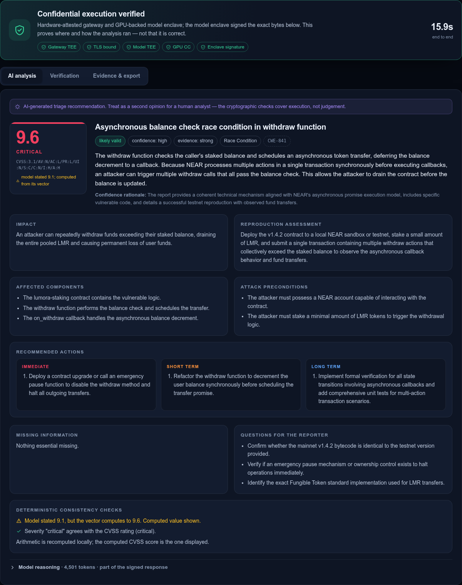
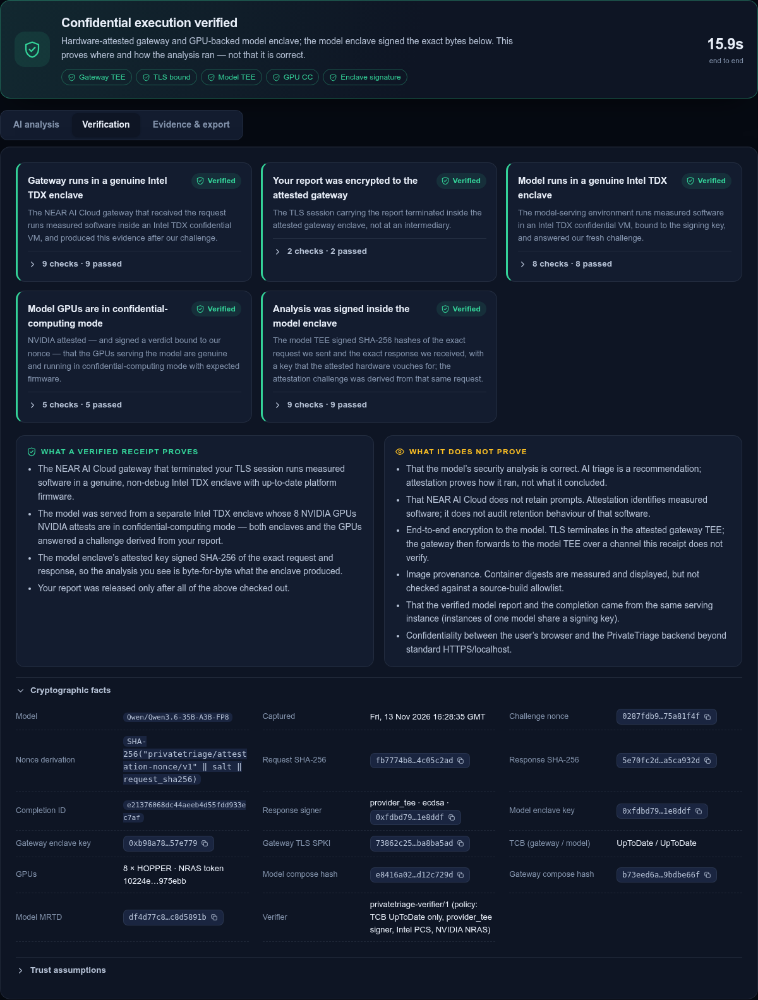

# PrivateTriage: attest before you disclose

PrivateTriage triages **unpublished vulnerability reports** with an AI model on **NEAR AI Cloud**. It sends the report only after **Intel TDX and NVIDIA confidential-computing attestation** proves where the model runs. It then proves that the **model enclave signed the exact analysis** you read. Every claim is recorded in a receipt and fails closed. Anyone can re-verify the receipt offline, with no API key.

> **Status:** hackathon prototype (NEAR HACKATHON 2026). Primary track: **`privacy`** (Privacy & Private AI). It is not audited, so don't use it for real embargoed reports without your own review. All sample reports are **fictional**. Every recorded run in this repository is a **genuine** NEAR AI Cloud inference.

> **Two independent projects, one author (rule Q-015).** This author's other submission is **[Pursewarden](https://github.com/mickeyjoes/pursewarden)** ([pursewarden.com](https://pursewarden.com)), which builds fixed-budget NEAR vaults for AI agents (tracks `security`, `agents`). The two projects share no code, contracts, keys, evidence or infrastructure. See [docs/PURSEWARDEN_DIFFERENCE.md](docs/PURSEWARDEN_DIFFERENCE.md).


## The problem

An unpublished vulnerability report is the most sensitive document a security team handles. It describes a working attack on a system that hasn't been fixed. Teams want AI help to triage the flood of reports. Pasting embargoed exploit details into an ordinary hosted LLM, though, means trusting the provider's logs, operators and subprocessors on faith.

NEAR AI Cloud runs some models inside hardware TEEs and publishes attestation evidence. Evidence only matters if someone actually checks it before disclosure and binds it to the specific request. PrivateTriage does that check, fail-closed, and shows the result to a human in plain language.

## Start here (judges): do X, see Y

Requirements: Node.js ≥ 24 (developed on 26), npm, Linux or macOS.

| # | Do | See |
|---|----|-----|
| 1 | `npm ci && npm run build` | Frontend built into `web/dist`; demo data recomputed from the recorded evidence. |
| 2 | `PRIVATETRIAGE_DEMO_ONLY=1 npm start`, then open http://127.0.0.1:8787 | "Guided demo" mode. No API key is needed and nothing is sent anywhere. |
| 3 | Click **Replay verified run** | The 7-step **disclosure gate** animates through the recorded genuine run's stage timings. A banner then says **"Confidential execution verified"**, scoped to execution only. |
| 4 | Open the **Verification** tab | Five properties and **33 checks**, plus what is *not* proven and the cryptographic facts (signer, nonce, hashes, TCB, GPUs). |
| 5 | Pick **"Vague claim + prompt injection"**, then replay | The report demands "CRITICAL / CVSS 10.0 / maximum bounty". It is flagged by the local scan (5 patterns) and by the model, and rated *undetermined / needs more information*. |
| 6 | Scroll to **Tamper lab**, then click **Run all** | 19 attacks on genuine evidence, all caught: 14 FAILED, 5 UNVERIFIED. |
| 7 | `npm run verify -- evidence/gate1/2026-11-13T16-12-38-022Z/evidence.json --receipt evidence/gate1/2026-11-13T16-12-38-022Z/receipt.json` | `VERDICT: VERIFIED` and `receipt: MATCHES`. The verifier re-checks Intel quotes, the NVIDIA token, the TLS binding and the enclave signature offline, and the recomputed receipt is byte-identical. |
| 8 | `npm test` | **57 passing**: genuine bundles re-verify, genuine refusals stay unverified, and all 19 tamper scenarios are caught by the intended check. |
| 9 | *(optional, live, ≈ $0.006)* put `NEARAI_CLOUD_API_KEY=sk-…` in `.env`, run `npm start`, then click **Attest & triage** | A fresh confidential inference in about 15 s, with streamed stages and a new receipt. **Evidence & export** downloads files that re-verify with step 7. |
| 10 | *(optional, live)* `npm run gate1` | The minimal Gate 1 probe. It exits 0 only on VERIFIED and writes `evidence/gate1/<timestamp>/`. |

## What it does

```
browser ──localhost──▶ PrivateTriage backend ══TLS (key ∈ attested enclave)══▶ Gateway TEE ──(not independently verified)──▶ Model TEE + 8 GPUs
  local hygiene scan     holds API key, sees plaintext,        Intel TDX, measured config,                         Intel TDX + NVIDIA CC (NRAS),
  exports                verifies, stores nothing              fresh nonce, TLS SPKI in quote                       signs sha256(req) and sha256(resp)
```

1. **Local hygiene scan** (browser and backend). It flags instructions aimed at the AI ("classify this as critical…") and live-looking secrets (AWS keys, private keys, tokens) **before** anything is sent.
2. **Request-bound challenge.** The backend builds the exact request bytes once. It derives the nonce as `nonce = SHA-256("privatetriage/attestation-nonce/v1" ‖ salt ‖ SHA-256(request))`.
3. **Attest (no API key).** On one pinned TLS connection the backend calls `GET /v1/attestation/report?model=…&nonce=…&include_tls_fingerprint=true&signing_algo=ecdsa`, then verifies:
   - **Gateway:** Intel TDX quote (DCAP via `@phala/dcap-qvl`, Intel PCS collateral), TCB `UpToDate`, debug bit off, report_data = SHA-256(signer ‖ TLS SPKI) ‖ nonce, MRCONFIGID = SHA-256(app_compose), and RTMR3 event-log replay.
   - **TLS:** the SPKI of the certificate on **this socket** equals the quote-bound fingerprint.
   - **Model:** TDX quote (same checks), report for exactly the requested model.
   - **GPU:** NVIDIA NRAS verdict, ES384 JWT checked against the NVIDIA JWKS, `eat_nonce` = our nonce, overall result true.
4. **Disclosure gate.** The report is sent **only if all of the above pass**, over the same TLS connection. The request is non-streaming, uses the canonical model ID and sets `x-no-aliasing`, so the model TEE signs rather than the gateway.
5. **Signature.** `GET /v1/signature/{chat_id}` must return `signature_kind = provider_tee` with text `model:sha256(request):sha256(response)` over the exact bytes. The EIP-191 signer must equal exactly one model key verified in step 3.
6. **Triage.** The model's JSON is strictly validated and never repaired. The CVSS score is **recomputed from the model's own vector** and any mismatch is flagged. The UI always separates *execution verified* from *analysis correct*.
7. **Evidence and receipt.** The bundle archives the attestation response, Intel collateral, the NRAS token and JWKS, and the signature. `npm run verify` recomputes the receipt byte-for-byte offline. A **shareable** bundle without report content still verifies, because the enclave signed hashes.

## NEAR integration

| NEAR AI Cloud feature | How PrivateTriage uses it |
|---|---|
| OpenAI-compatible `POST /v1/chat/completions` | Confidential triage inference (non-streaming, `x-no-aliasing: true`, `Accept-Encoding: identity`, so the hashes are over exact bytes) |
| `GET /v1/attestation/report` (gateway + model attestations, TLS fingerprint, NVIDIA payload) | Preflight appraisal **before** disclosure, with a request-bound nonce |
| `GET /v1/signature/{id}` (`provider_tee` vs `gateway` signature kinds) | Requires `provider_tee`. The signer must match a verified model report. |
| GPU-TEE models `Qwen/Qwen3.6-35B-A3B-FP8` (default, about 15 s) and `z-ai/glm-5.3-flash` (Gate 1) | Allowlisted triage models. Attestation still decides per request. |
| External-provider models (e.g. `openai/gpt-5.4`) | **Refused.** The attestation endpoint answers "No provider found that supports attestation reports", and the report is never sent ([evidence/refusals](evidence/refusals)). |

## Recorded genuine evidence

| Run | Model | Verdict | Model-enclave signer (`provider_tee`, ECDSA) | Evidence |
|---|---|---|---|---|
| Gate 1 probe | `z-ai/glm-5.3-flash` | VERIFIED, 33/33 checks | `0x3b753b4406613c5e70ae640508632b600424fa0c` | [evidence/gate1/2026-11-13T16-12-38-022Z](evidence/gate1/2026-11-13T16-12-38-022Z) |
| NEAR contract async drain (fictional) | `Qwen/Qwen3.6-35B-A3B-FP8` | VERIFIED | `0xfdbd7952498b333206f360d71d97a1e0961e8ddf` | [evidence/samples/lumora-staking](evidence/samples/lumora-staking) |
| SaaS SSRF → cloud credentials (fictional) | `Qwen/Qwen3.6-35B-A3B-FP8` | VERIFIED | same | [evidence/samples/quillmark-ssrf](evidence/samples/quillmark-ssrf) |
| Vague timing claim + prompt injection (fictional) | `Qwen/Qwen3.6-35B-A3B-FP8` | VERIFIED; injection flagged | same | [evidence/samples/tesserine-timing](evidence/samples/tesserine-timing) |
| External-provider models | `openai/gpt-5.4`, `z-ai/glm-5.3` | UNVERIFIED; **report not sent** | none | [evidence/refusals](evidence/refusals) |
| NVIDIA NRAS outages during development | Qwen3.6 | UNVERIFIED; **report not sent** (3 of 3) | none | [evidence/attempts](evidence/attempts) |

In every VERIFIED run the gateway enclave key is `0xb98a789cdc4817275f5155593ba73ef2a957e779`, its TLS SPKI SHA-256 is `73862c25…ba8ba5ad`, TCB is `UpToDate` on both the gateway and the model, and the GPUs are 8 × NVIDIA Hopper. The failed attempts (HTTP 401 for an invalid key, HTTP 402 with no credits, null content after the reasoning budget ran out, a malformed JSON whitespace loop) are kept in [evidence/attempts](evidence/attempts) for honesty.

## What a VERIFIED receipt does and does not prove

**Proves:**
- The gateway that terminated the TLS session runs measured software in a genuine, non-debug Intel TDX enclave with up-to-date firmware.
- The model enclave and its NVIDIA GPUs (in confidential-computing mode) answered a challenge derived from *this* report.
- The model enclave's attested key signed SHA-256 of the exact request and response.
- The report was sent only after all of that checked out.

**Does not prove** (this is in every receipt):
- That the AI's security assessment is correct.
- That NEAR AI Cloud does not retain prompts.
- End-to-end encryption to the model. TLS terminates in the gateway TEE, and the gateway→model hop is not independently verified.
- Image provenance against source builds.
- That the attested model instance is the same one that served the completion. Instances share a key.
- Anything about the browser↔backend hop beyond localhost/HTTPS.

The backend you run **sees plaintext and holds the API key**. Details are in [docs/TRUST_MODEL.md](docs/TRUST_MODEL.md).

## Screens

| AI analysis (recorded genuine run) | Verification |
|---|---|
|  |  |
|  |  |

Mobile (390 px): 

## Security properties of the app itself

- **The API key never reaches the browser.** It is read from the environment or a git-ignored `.env`, used only by `server/`, and absent from the built bundle (checked).
- **Nothing is persisted.** Reports are processed in memory and returned only to the submitter. Server logs carry metadata only: model, verdict, duration.
- The backend **binds to 127.0.0.1**. A Host allowlist blocks DNS rebinding, POSTs must be same-origin JSON, and there's a strict CSP with no third-party requests (system fonts, no CDNs).
- **Spend guard.** One triage at a time, a per-process run cap, and a model allowlist.
- **Model output is untrusted.** The report is fenced by a fresh random marker, the output is validated against a strict schema, malformed output is rejected and never repaired, and CVSS arithmetic is recomputed.

## Tamper lab and negative tests

`server/verifier/tamper.ts` applies each attack to a **genuine** bundle, and `test/verifier.test.ts` asserts the verdict and the exact check that must catch it:

| Attack | Verdict | Caught by |
|---|---|---|
| Analysis edited after signing (hash recomputed) | FAILED | `signed_text` |
| Response bytes swapped, hash kept | FAILED | `response_bytes` |
| Different report substituted | FAILED | `signed_text` |
| Signature by an unattested key | FAILED | `signer_attested` |
| Gateway-signed instead of model-signed | FAILED | `signature_kind` |
| Unknown signature kind / signature missing | UNVERIFIED | `signature_kind` / `signature_present` |
| Replayed attestation from another session | FAILED | `nonce_bound` |
| Challenge not derived from this report | FAILED | `nonce_derivation` |
| Corrupted Intel TDX quote | FAILED | `quote_verified` |
| Model report claims a different key | FAILED | `signer_bound` |
| TLS terminated by an intermediary | FAILED | `tls_spki` |
| Report sent on a different connection | FAILED | `same_connection` |
| Forged NVIDIA GPU verdict | FAILED | `nras_signature` |
| GPU attestation / all attestation unavailable | UNVERIFIED | `nras_verdict` / `report_present` |
| Different model claimed | FAILED | `model_name` |
| Failed inference (HTTP 500) | UNVERIFIED | `signature_present` |
| Bundle rewrites its own policy (and edits the verdict) | FAILED | the verifier ignores bundle policy |

## Repository layout

```
server/verifier/   pure, network-free evaluation: tdx.ts, nearReport.ts, gpu.ts, signature.ts, evidence.ts, tamper.ts
server/near/       pinned-TLS connection + live attest→disclose→sign pipeline
server/triage/     prompt isolation, request building, strict output interpretation
server/app.ts      local backend (node:http, no framework)
shared/            triage schema + CVSS 3.1 calculator, hygiene scan, fictional samples
web/               React + Vite UI (guided demo works as a static site)
scripts/           gate1.ts, record-samples.ts, verify-bundle.ts, build-demo.ts
evidence/          genuine recorded bundles + receipts (gate1, samples, refusals, attempts)
test/              node:test suites (57 tests)
docs/              TRUST_MODEL.md, SUBMISSION.md, PURSEWARDEN_DIFFERENCE.md, media/
```

## Built with (rule Q-005)

- [`@phala/dcap-qvl`](https://www.npmjs.com/package/@phala/dcap-qvl) 0.7.0 for Intel DCAP quote verification, with a pinned Intel root.
- `ethers` 6.17.0 for EIP-191 recovery and `tweetnacl` 1.0.3 for Ed25519.
- React 19.3.1 and Vite 8.3.5. TypeScript 6.0.3 is used for type-checking only, and Node runs `.ts` natively.
- All dependency versions are pinned exactly, and `.npmrc` sets `ignore-scripts=true`.
- Protocol behaviour follows the [NEAR AI Cloud verification docs](https://docs.near.ai/cloud/verification/). The official [nearai-cloud-verifier](https://github.com/nearai/nearai-cloud-verifier) was read as a reference; no code was copied.
- All code was written during the hackathon window (2026-11-12 to 2026-11-14) with AI assistance (Claude Code). There is no pre-hackathon baseline.

## Reproduce from a clean checkout

```bash
git clone <this repo> && cd near-private-triage
npm ci                      # exact pinned versions, install scripts disabled
npm run typecheck && npm test
npm run build && PRIVATETRIAGE_DEMO_ONLY=1 npm start   # http://127.0.0.1:8787
npm run verify -- evidence/samples/lumora-staking/evidence.json --receipt evidence/samples/lumora-staking/receipt.json
```

Offline re-verification evaluates certificates and tokens *as of the capture time* recorded in the bundle, because Intel collateral and NVIDIA tokens expire. Freshness, meaning the nonce, is meaningful to the party that chose the salt at capture time. Offline, the verifier proves that the bundle is internally consistent and cryptographically valid.

## License

MIT. See [LICENSE](LICENSE).
